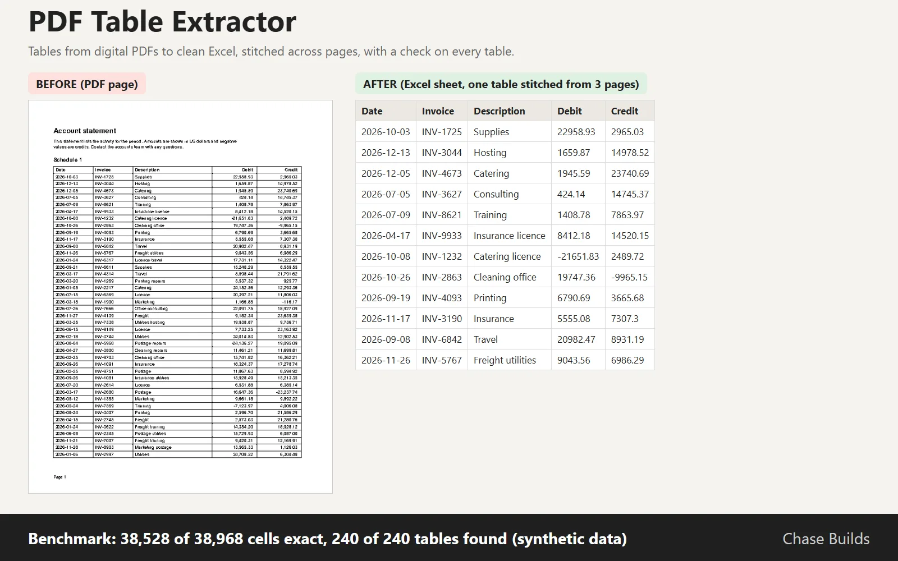

# pdf-table-extractor

[](https://github.com/chasebuilds/pdf-table-extractor/actions/workflows/ci.yml)  [](LICENSE)

Pulls tables out of digital PDFs (statements, reports, price lists, invoices) into an Excel workbook with one sheet per table, or into CSV files. It finds the header row, joins a table that runs across pages into one, and turns printed numbers like `$1,234.50` and `(56.00)` into real numbers. Every table is checked, and any table that fails a check is listed on a Review sheet with the reason, so you know which ones to look at before you trust them.



## Measured result

Tables were drawn into PDFs from a seed, so every cell is known, and the extracted cells were compared with the truth. The table below is written by the benchmark script from a real run, not typed by hand. Method and limits: [BENCHMARK.md](BENCHMARK.md).

<!-- benchmark:start -->
| Measure | Count | Rate |
|---|---:|---:|
| Cells extracted exactly (header + body) | 38,528 / 38,968 | **98.9%** |
| Tables found | 240 / 240 | **100.0%** |
| Headers detected | 240 / 240 | **100.0%** |
| Multi-page tables stitched into one | 79 / 80 | **98.8%** |
| Planted wrong Total rows flagged | 52 / 53 | **98.1%** |
| Planted unparseable numbers flagged | 44 / 44 | **100.0%** |
| Clean tables flagged by mistake | 0 / 143 | **0.0%** |

200 PDFs, 332 pages, 240 tables. Extraction time: 11.9 s total, 36 ms per page.
<!-- benchmark:end -->

The one missed stitch and the one missed wrong total are the same table: its last page held only the repeated header and the Total row, which is too short to be read as a table, so the Total row was lost. [LIMITATIONS.md](LIMITATIONS.md) has this and the other limits.

## Quick start

Windows (on macOS or Linux use `.venv/bin/` in place of `.venv\Scripts\`):

```
python -m venv .venv
.venv\Scripts\python -m pip install -e .
.venv\Scripts\pdftables extract samples\doc_002_space_multipage.pdf -o out.xlsx --csv-dir out-csv
```

That prints:

```
REVIEW doc_002_space_multipage.pdf table 1: 83 rows x 3 cols, page 1,2
         total: column 'Revenue' Total row says 816,196.68, column sums to 815,862.18
doc_002_space_multipage.pdf: 1 table(s), 1 flagged -> out.xlsx
```

That sample has a planted wrong total. The answers for every sample are in the `.json` next to each PDF in [`samples/`](samples/), and the extracted workbooks and CSVs are in [`samples/out/`](samples/out/).

Give it a folder instead of a file and it writes one workbook per PDF into the `-o` folder (default `pdftables-out`).

| Option | Effect |
|---|---|
| `-o PATH` | workbook to write (default: the PDF name with `.xlsx`); for a folder input, the output folder |
| `--csv-dir DIR` | also write one CSV per table, named `<pdf>_table_<n>.csv` |

Exit codes: `0` every table passed its checks, `1` at least one table is flagged for review, `2` the input could not be read.

As a library:

```python
from pdf_table_extractor import extract_pdf, write_xlsx

tables = extract_pdf("statement.pdf")
for t in tables:
    print(t.pages, t.header, len(t.rows), t.problems)
write_xlsx(tables, "statement.xlsx")
```

## The workbook

- **Review** (first sheet): one row per table with its source file, pages, size, whether a header was found, `OK` or `REVIEW`, and the reasons. Flagged rows are highlighted.
- **Table 1, Table 2, ...**: the header in bold and frozen, then the rows. Numbers are stored as numbers, so sums and filters work straight away.

## The checks

| Check | Flags the table when |
|---|---|
| Column count | two values in one row landed in the same column (usually a cell that spills across columns) |
| Numbers parse | a column that is mostly numbers has values that are not numbers, such as `1,234.5O` |
| Total row | a row starting with `Total` or `Grand total` does not equal the sum of the rows above it, column by column (to the cent) |

A column with a bad value is left out of the total check, since its sum is not known.

## How it works

1. **Ruled tables.** pdfplumber finds tables from the drawn grid lines.
2. **Whitespace tables.** The remaining words are grouped into lines, and words into cells wherever the gap is wider than a space. Runs of three or more lines with two or more cells make a table. Columns are the vertical strips of the page that some cell covers, so left-aligned text and right-aligned numbers both line up.
3. **Header.** The first row is the header when it has at least two filled cells, none of them numbers, and the rows below have numbers.
4. **Stitching.** The first table on a page continues the last table on the page before when the column count matches, the earlier part has no Total row, and either the header repeats (it is dropped) or every column lines up within 3 points on its left or right edge.
5. **Cleaning.** Whitespace is collapsed. Thousands separators, currency signs (`$`, `£`, `€`), leading minus signs and parentheses for negatives are read into numbers. Codes with a leading zero, dates and IDs stay text.
6. **Checks and output.** See above.

## Limits

Short version: digital PDFs only (no scans, no OCR), one header row, no merged or wrapped cells, and the generated benchmark files are cleaner than real ones. The full list is in [LIMITATIONS.md](LIMITATIONS.md).

## Development

```
.venv\Scripts\python -m pip install -e ".[dev]"
.venv\Scripts\python -m pytest --cov
.venv\Scripts\python -m ruff check .
.venv\Scripts\python -m mypy
.venv\Scripts\python -m benchmark.run_benchmark --count 200 --seed 1
```

The sample PDFs were made with `python -m benchmark.generate --out samples --count 5 --seed 7`.

## License

MIT. See [LICENSE](LICENSE).
